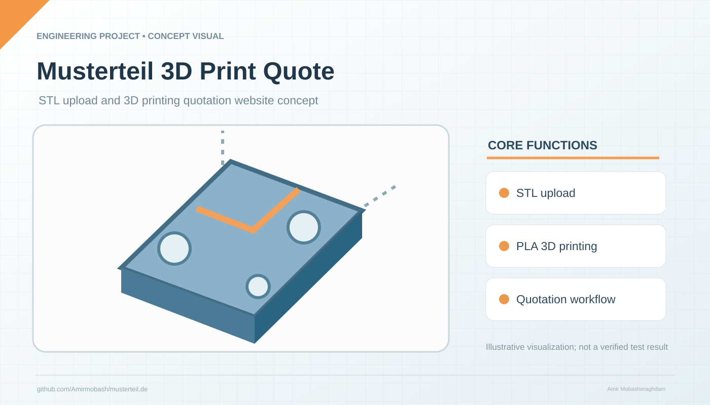

# Musterteil – No Scroll Instant Quote Startseite

Conceptual illustration; not a verified hardware photograph or exact CAD export.

Die Startseite ist bewusst als fast bildschirmfüllende Quote-Seite aufgebaut:
- Keine lange Scroll-Landingpage auf der Startseite
- Zentrum: Datei hochladen / Preis erhalten
- Inspiriert von On-Demand-Manufacturing UX
- Inhaltlich angepasst an Businessplan: PLA 3D-Druck, STL-Dateien, Einzelstücke, Prototypen, Kleinserien

Wichtig: GitHub Pages speichert keine echten Datei-Uploads. Die Datei wird lokal im Browser gelesen.
